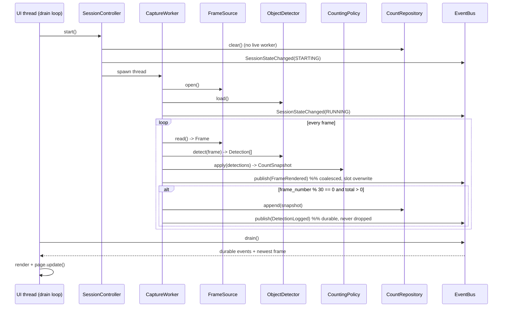
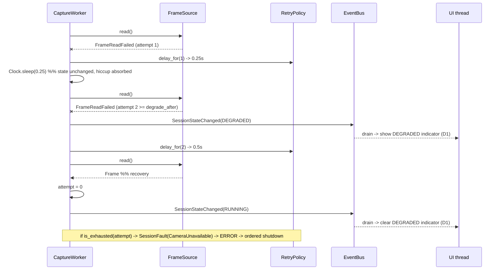

# Design: Clean Architecture Refactor of the Stock Detection App

- **Change**: `refactor-clean-architecture`
- **Phase**: design
- **Inputs**: `proposal.md` (authoritative, incl. Resolved Decisions D1–D3), `explore.md`, `openspec/config.yaml`
- **Owns**: configuration mechanism, port signatures, queue contract, threading/shutdown model, retry policy, dependency-rule enforcement, `app.py` decomposition plan

## Technical Approach

Domain-first extraction executed as a strangler fig. Five packages under `src/depot_vision/`; every source dependency points inward. Concurrency is confined to two threads with one owner per mutable structure, and every infrastructure call sits behind a `typing.Protocol` port so the whole system is exercisable with no camera, no GPU and no model weights.

```
presentation (Flet) ─┐
adapters (cv2, YOLO, pandas, fs) ─┤──► ports (Protocol) ──► application ──► domain (stdlib only)
```

### Module map

| Path | Contents |
|---|---|
| `domain/frames.py` | `PixelBuffer`, `Frame`, `EncodedImage`, `Overlay` |
| `domain/detections.py` | `BoundingBox`, `Detection` |
| `domain/counting.py` | `TargetClass`, `TARGET_CLASSES`, `CountSnapshot`, `CountingPolicy` |
| `domain/session.py` | `SessionState`, legal-transition table |
| `domain/retry.py` | `RetryPolicy` (pure schedule + budget) |
| `domain/metrics.py` | `FpsMeter` (pure, from monotonic timestamps) |
| `domain/events.py` | `AppEvent` hierarchy, `EventClass` |
| `domain/config.py` | `AppConfig`, `AppConfig.from_mapping` (coercion + validation) |
| `domain/errors.py` | `CameraUnavailable`, `FrameReadFailed`, `InferenceFailed`, `ExportFailed`, `InvalidConfiguration`, `InvalidTransition` |
| `ports/__init__.py` | the nine Protocols |
| `application/session_controller.py` | state machine, commands, ordered shutdown |
| `application/capture_loop.py` | worker body (pure orchestration over ports) |
| `adapters/**` | `opencv_frame_source`, `ultralytics_detector`, `cv2_annotator` (+ BGR palette), `cv2_encoder`, `in_memory_repository`, `pandas_csv_exporter`, `bounded_event_bus`, `system_clock`, `layered_config_provider` |
| `presentation/**` | `flet_app`, `view`, `event_renderer`, `theme` |
| `weights/yolov8n.pt` | package-relative weights (FT8) |

`TARGET_CLASSES` (label, Spanish name, emoji — PRESERVE 1) is domain: it defines the counted set. `CLASS_COLORS` (BGR — PRESERVE 3) ships with the annotator adapter: it is a drawing detail, and BGR ordering is an OpenCV convention.

## Architecture Decisions

### D-A: Configuration — layered resolution, pure `AppConfig` core

**Choice**: precedence `CLI flags > environment (DEPOT_VISION_*) > INI file > built-in defaults`. Adapters only *gather* string layers and merge them into one `Mapping[str, str]`; `AppConfig.from_mapping()` in the domain does all coercion and validation and raises `InvalidConfiguration`. Tests construct `AppConfig(...)` directly or use `StaticConfigProvider`.

| Alternative | Rejected because |
|---|---|
| Env vars only | A non-developer operator cannot set env vars for a double-clicked desktop app. |
| CLI flags only | Same, and settings would not persist between runs. |
| TOML file | `tomllib` is 3.11+; the target is 3.10.12, so TOML costs a `tomli` dependency for four keys. |
| JSON file | Stdlib, but no comments and it punishes hand-editing — the primary use case. |

**Rationale**: INI via stdlib `configparser` is the only format that is hand-editable *and* free. The layering exists so the operator gets a persistent file, CI gets env vars, and a developer gets flags — while the domain sees a frozen dataclass, so **no test ever touches the environment or the filesystem to inject configuration**.

File search order (first hit wins, not merged): `$DEPOT_VISION_CONFIG` → `./depot_vision.ini` → `~/.config/depot_vision/config.ini`. Missing file is not an error.

| Key | Default | Note |
|---|---|---|
| `confidence_threshold` | `0.4` | PRESERVE 2 |
| `model_weights` | `yolov8n.pt` | Relative names resolve **package-relative** to `depot_vision/weights/`, never to cwd (FT8, FIX 9) |
| `export_dir` | `~` | Home is the only directory guaranteed to exist and be writable on every target OS (FIX 5); the exporter `mkdir(parents=True, exist_ok=True)` |
| `camera_index` / `frame_width` / `frame_height` | `0` / `640` / `480` | |
| `target_fps` | `30` | |
| `queue_soft_capacity` / `queue_hard_ceiling` | `1024` / `8192` | FT3 |
| `stop_timeout_s` | `5.0` | FT4 |
| `log_retention` | `200` | Matches current `[:200]` trim |

### D-B: Ports — nine Protocols, no infrastructure types

`PixelBuffer = Any`, documented as opaque: only adapters may interpret it. This keeps `numpy` out of the domain while letting a real frame flow through untouched.

```python
class FrameSource(Protocol):
    def open(self) -> None: ...            # raises CameraUnavailable
    def read(self) -> Frame: ...           # raises FrameReadFailed
    def close(self) -> None: ...           # idempotent
    @property
    def is_open(self) -> bool: ...

class ObjectDetector(Protocol):
    def load(self) -> None: ...                              # raises InferenceFailed
    def detect(self, frame: Frame) -> Sequence[Detection]: ...  # raises InferenceFailed

class FrameAnnotator(Protocol):
    def annotate(self, frame: Frame, snapshot: CountSnapshot, overlay: Overlay) -> Frame: ...

class FrameEncoder(Protocol):
    def encode(self, frame: Frame) -> EncodedImage: ...

class CountRepository(Protocol):
    def append(self, snapshot: CountSnapshot) -> None: ...
    def snapshot(self) -> tuple[CountSnapshot, ...]: ...
    def clear(self) -> None: ...           # raises InvalidTransition if a worker is live

class CountExporter(Protocol):
    def export(self, history: Sequence[CountSnapshot], destination_dir: Path) -> Path: ...

class EventBus(Protocol):
    def publish(self, event: AppEvent) -> None: ...   # never blocks, never raises
    def drain(self) -> Sequence[AppEvent]: ...

class Clock(Protocol):
    def now(self) -> datetime: ...        # wall clock, for CSV timestamps
    def monotonic(self) -> float: ...     # FPS and backoff
    def sleep(self, seconds: float) -> None: ...

class ConfigProvider(Protocol):
    def load(self) -> AppConfig: ...
```

`annotate` transfers ownership: adapters may draw into the underlying buffer in place, so the returned `Frame` is the only valid handle afterwards. `Clock.sleep` stays on `Clock` rather than becoming a tenth port — it is time-cohesive, and a `FakeClock` then drives the entire retry schedule with zero real delay.

### D-C: Event bus — two lanes, evidence is never discarded (implements D2)

Structure: one `threading.Lock` guarding a `collections.deque` (durable lane) plus a single-slot `_latest_frame` reference (frame lane).

| Event class | Structure | Overflow behavior |
|---|---|---|
| `FrameRendered` | single slot, capacity 1 | Publishing overwrites the slot. Coalescing is structural: overflow cannot occur. |
| `SessionStateChanged` | durable deque | Never dropped. |
| `LogEmitted`, `DetectionLogged`, `SessionFault` | durable deque | Never dropped; bounded by presentation-side retention (`log_retention`), not by the bus. |

**When a non-droppable event arrives at a full queue** (`len >= queue_soft_capacity`): the bus **appends it anyway** and publishes one `QueueSaturated` diagnostic, re-armed only after the length falls below `soft_capacity // 2`. At `queue_hard_ceiling` the bus publishes `SessionFault(QueueOverflow)`; the controller treats that as a session fault, transitions to `ERROR` and runs ordered shutdown. Producers are never blocked and nothing but pixels is ever discarded.

`drain()` returns the durable events in FIFO order followed by the coalesced frame (newest pixels render last, in the same `page.update()`), then clears both lanes.

| Alternative | Rejected because |
|---|---|
| `queue.Queue(maxsize)` | Full means block (stalls capture, deadlocks shutdown) or raise (drops evidence). No coalescing. |
| `deque(maxlen=N)` | Silently evicts the oldest — exactly the discarded-error-log failure D2 forbids. |
| Uniform newest-wins | Superseded by D2. |

### D-D: Threading and shutdown

Two threads only.

| Thread | Owns |
|---|---|
| UI thread (Flet page + asyncio loop) | All Flet controls, `SessionController` commands, the single drain loop |
| Capture worker (`threading.Thread`, `daemon=True`) | `FrameSource`, `ObjectDetector`, and **exclusive write access to `CountRepository`** |

**History ownership (FT7)**: the capture worker is the *only* writer (`append`). `snapshot()` returns an immutable tuple copy under the lock and is safe from any thread (Export reads it from the UI thread). `clear()` is legal only in `IDLE`/`ERROR` with no live worker and raises `InvalidTransition` otherwise — Start clears *before* spawning the thread. FIX 4's clear/append/read interleaving is removed by construction, not by a bigger lock.

`daemon=True` is retained as a process-exit safety net only; it is never the shutdown mechanism.

**Ordered shutdown (FT4)**: signal → drain → `join(timeout)` → **release**. The camera is released by the controller *after* a successful join, not by the worker's `finally`. Releasing from the UI thread while the worker may be inside `cap.read()` is unsafe; after a successful join the thread is provably gone, which is precisely why release follows join. The alternative (worker releases in `finally`) was rejected because it makes "released" unobservable to the controller and inverts the FT4 ordering.

**Join timeout**: Python cannot safely kill a thread. On timeout the controller does **not** close the camera. It publishes `ShutdownTimedOut(timeout_s)`, transitions to `ERROR`, retains the thread in `_orphans`, and **locks out Start** so a second worker can never contend for the device. Export stays enabled. A later `stop()` re-joins the orphan; on success it reaps it, closes the source and returns to `IDLE`. The join itself runs via `loop.run_in_executor` so the UI stays responsive — Stop *completes* only on the join outcome (never a fire-and-forget flag), but it does not freeze the UI thread.

**Drain loop (FIX 2)**: started exactly once at page mount, guarded by `_ui_loop_started`, with a terminating condition `while not self._ui_stop.is_set()`. It is no longer started in `on_start`. `page.update()` failures are published as `SessionFault`, never `except Exception: pass` (FIX 11).

### D-E: Retry and backoff (FT1)

`RetryPolicy(base_delay, max_delay, max_attempts, degrade_after)` — a pure domain value object with `delay_for(attempt)` and `is_exhausted(attempt)`.

| Surface | base | cap | max attempts | degrade after |
|---|---|---|---|---|
| Camera open / frame read | `0.25 s` | `4.0 s` | `8` (≈19.75 s total) | `2` consecutive failures |
| Inference | `0.25 s` | `1.0 s` | `3` | `2` |

`delay_for(n) = min(base * 2**(n-1), cap)`. **No jitter**: a single-camera desktop app has no thundering-herd problem, and a deterministic schedule is exactly assertable against a `FakeClock`. Inference gets a smaller budget because a broken model does not self-heal the way a re-enumerating USB device does.

**Transitions**: failure 1 → retry, state unchanged (absorbs single-frame hiccups without flickering the D1 indicator). Failure ≥ `degrade_after` → `DEGRADED` + `SessionStateChanged`. Any successful read *and* inference → counter resets to 0, state returns to `RUNNING` + `SessionStateChanged` (D1 indicator clears). `is_exhausted` → `SessionFault(CameraUnavailable)`, state `ERROR`, ordered shutdown.

### D-F: Dependency-rule enforcement — staged, both mechanisms

| Option | Tradeoff |
|---|---|
| Custom `ast`-walk pytest | Zero new dependencies, runs under the configured `pytest` command, precise failure message, ~40 lines. Catches only static imports. |
| `import-linter` (`layers` contract) | Declarative, expresses all five layer directions. Adds a dependency and a second CI command. |
| `mypy` module bans | Cannot express import direction at all. |

**Recommendation**: Phase 1 lands `tests/architecture/test_dependency_rule.py` — an `ast` walk over `src/depot_vision/domain/**/*.py` asserting every top-level import is in `sys.stdlib_module_names` (available in 3.10) or under `depot_vision.domain`. It satisfies the success criterion under the one command `openspec/config.yaml` declares, and it works in Phase 1 when the other layers do not exist yet. Phase 2 adds `import-linter` with a `layers` contract (`presentation > adapters > ports > application > domain`) for the inter-layer directions the hand-rolled test would express badly. Known gap, documented in the test: dynamic `importlib`/`__import__` is not detected.

### D-G: Flet pin — `flet>=0.84.0,<0.86.0`

**Original rationale (corrected)**: the exploration originally claimed `Image.src_bytes` was verified against the 0.84.0 documentation, and the pin ceiling followed from that claimed capability. That claim is false: re-verified directly against the installed package (`flet==0.85.3` resolved in `.venv-linux/`, and independently `flet==0.84.0`, the pin floor), there is no `src_bytes` attribute anywhere in this Flet generation — `Image.src` has always accepted `bytes` directly (see `explore.md` section 1). FIX 1 is withdrawn on this basis.

The pin's practical purpose is unchanged by this correction: pre-1.0 Flet minors are breaking, so the ceiling stays the next minor after the claimed runtime (0.85.1 per the module docstring). It no longer rests on a `src_bytes` capability claim, though — it rests on `Image.src` continuing to accept `bytes` directly, which is the actual capability the presentation layer depends on.

Phase 0's CI capability assertion is corrected accordingly: `scripts/check_flet_capability.py` no longer sniffs `hasattr(ft.Image, "src_bytes")` — that check was always `False` on the pinned range and failed the build unconditionally, independent of any real regression. It instead runs a positive functional check: construct `ft.Image(src=b"...")` and assert the value survives as `bytes`. It still reports the resolved Flet version.

The `FrameEncoder` port still returns `EncodedImage(data, media_type)`, so if a future Flet ever drops direct `bytes` support from `Image.src`, only `presentation/event_renderer.py` changes — the pin stays cheap.

## Data Flow

```
FrameSource ─► Frame ─► ObjectDetector ─► Detection[] ─► CountingPolicy ─► CountSnapshot
                 │                                                    │        │
                 └──────────────► FrameAnnotator ◄────────────────────┘        ▼
                                       │                              CountRepository
                                       ▼                                       │
                                  FrameEncoder ─► EncodedImage                  ▼
                                       │                               CountExporter ─► CSV
                                       ▼
                                    EventBus ─► drain loop ─► Flet controls ─► page.update()
```

## Sequence Diagrams

### 1. Detection loop — happy path



### 2. Camera failure → DEGRADED → recovery



### 3. Ordered shutdown (with timeout branch)

```mermaid
sequenceDiagram
    participant UI as UI thread
    participant C as SessionController
    participant W as CaptureWorker
    participant FS as FrameSource
    participant B as EventBus

    UI->>C: stop()
    C->>B: SessionStateChanged(STOPPING)
    C->>W: _stop_requested.set()          %% 1. signal
    UI->>B: drain() + render                %% 2. drain
    W->>W: exit loop at head
    W->>B: publish(CaptureLoopExited)
    C->>W: await join(stop_timeout_s)       %% 3. join, via run_in_executor
    alt join succeeds
        C->>FS: close()                     %% 4. release, thread provably gone
        C->>B: SessionStateChanged(IDLE)
    else join times out
        C->>B: ShutdownTimedOut(timeout_s)
        C->>C: state = ERROR; orphan retained; Start locked out
        Note over C,FS: camera NOT closed — orphan may be inside read().<br/>A later stop() re-joins, reaps and closes.
    end
    UI->>B: final drain() + render
```

## File Changes

| File | Action | Description |
|---|---|---|
| `src/depot_vision/**` | Create | Five layers per the module map |
| `tests/domain/**`, `tests/application/**`, `tests/adapters/**`, `tests/architecture/**` | Create | Per-layer suites |
| `tests/fixtures/**` | Create | Recorded JPEG frames + a serialized detection set |
| `app.py` | Modify (Phase 5–6 only) | Flet wiring → controller; then thin entrypoint |
| `requirements.txt` | Modify | `flet>=0.84.0,<0.86.0`; pinned floors for the rest |
| `pyproject.toml` | Create | pytest, ruff, mypy, coverage, `import-linter` contract |
| `.github/workflows/ci.yml` | Create | ruff + mypy + pytest + Flet capability assertion |
| `depot_vision.ini.example` | Create | Operator-facing configuration template |

## `app.py` Decomposition and Incremental Testing

Phases 0–4 leave `app.py` **byte-identical**, enforced mechanically: `tests/architecture/test_monolith_frozen.py` asserts `sha256(app.py)` equals the `193c577` baseline digest. Deleting that test is part of the Phase 5 diff and is the explicit signal that the freeze is lifted.

| Phase | `app.py` | Extracted from | New tests |
|---|---|---|---|
| 0 | frozen | — | freeze test; Flet capability assertion |
| 1 | frozen | lines 19–42, 126–131 (target set, counting rule) | `CountingPolicy`, `CountSnapshot`, `RetryPolicy`, `FpsMeter`, transition table, `AppConfig.from_mapping` — pure, no mocks; dependency-rule test |
| 2 | frozen | — (contracts only) | Protocol conformance via in-memory fakes; layered config precedence (CLI > env > INI > default) with an injected mapping |
| 3 | frozen | 92–121, 88/123, 132–151, 220–222, 384–394 | Adapter tests on recorded fixtures: encode/annotate golden bytes, atomic export (temp + `os.replace`, interrupted-write case), repository single-writer + snapshot copy, `FakeClock`-driven backoff |
| 4 | frozen | 44–56, 345–382 (state machine, lifecycle) | Controller tests with fake ports: full transition matrix, DEGRADED entry/exit, ordered shutdown, join-timeout branch, queue lanes (coalesce vs never-drop vs saturation vs hard ceiling) |
| 5 | **modified** | 64–249 rewired, 275–343 replaced | `main()` splits into `presentation/view.py` (controls), `event_renderer.py` (event → control), `theme.py`; `Image.src = bytes` (unchanged behavior, FIX 1 withdrawn) + `gapless_playback=True` (ENH-1); one drain loop; renderer tests over synthetic event streams. **Mandatory D3 user validation gate on the target machine before Phase 6, on presentation-rewiring grounds.** |
| 6 | **modified** | delete `detection_worker`, `AppState`, module globals | `app.py` = `from depot_vision.presentation.flet_app import run; run()`; smoke test that the entrypoint imports and builds the page with fake ports |

## Testing Strategy

| Layer | What | Approach |
|---|---|---|
| Unit (domain) | Counting policy, retry schedule, FPS, transitions, config coercion | Pure functions; **no mocks, no I/O, no hardware** |
| Unit (application) | Controller states, shutdown ordering, join timeout, queue lanes | In-memory fake ports + `FakeClock`; `threading.Event` handshakes, no `sleep`-based timing |
| Integration (adapters) | Encoder, annotator, exporter, repository, config provider | Recorded JPEG/detection fixtures; `tmp_path` for filesystem; **no camera, no GPU, no weights** |
| Architecture | Dependency rule; `app.py` freeze | `ast` import walk; SHA-256 digest assertion |
| Manual (E2E) | Live feed, model load, `Image.src` (bytes) rendering, presentation-layer rewiring | User-run on the target machine — the D3 gate at Phase 5 |

Strict TDD: every FIX and FT item lands as RED → GREEN, one test that fails against the current behavior first.

## Threat Matrix

| Boundary | Applicability | Design response |
|---|---|---|
| Documentation-like paths | N/A — no file is classified or executed by extension or name |
| Git repository selection | N/A — the app performs no VCS operation |
| Commit state | N/A |
| Push state | N/A |
| PR commands | N/A |

No routing, shell, subprocess, VCS/PR automation, executable-file classification or process-integration boundary exists in this design.

**Scoped filesystem-input safeguard (design-owned, not a matrix row)**: `model_weights` and `export_dir` become operator-configurable. `torch.load` of a `.pt` file deserializes a pickle, so an arbitrary weights path is an arbitrary-code-execution surface. Response: relative `model_weights` values resolve **only** inside `depot_vision/weights/` (path is resolved and asserted to be a descendant; `..` traversal raises `InvalidConfiguration`); absolute paths are accepted but logged at startup as an explicit operator override. `export_dir` is resolved and created with `mkdir(parents=True, exist_ok=True)`; the CSV filename is generated, never operator-supplied.

## Migration / Rollout

No data migration. Rollout is the seven-phase strangler chain from the proposal; phases 0–4 are additive and unrouted, so deleting `src/depot_vision/` restores the exact `193c577` runtime path. Delivery is `auto-chain`: each phase is one stacked PR ≤400 changed lines, targeting the previous phase's branch, and leaves the app runnable.

## Open Questions

- [ ] If the orphaned worker blocks forever inside `cv2.VideoCapture.read()`, the reap path never completes and the device stays held until process exit. Mitigation where the backend supports it: `CAP_PROP_OPEN_TIMEOUT_MSEC` / `CAP_PROP_READ_TIMEOUT_MSEC` (V4L2 support varies). Residual risk accepted; `daemon=True` guarantees the process can still exit.

**Resolved**: the `flet` `<0.86.0` ceiling / `Image.src_bytes` capability question (formerly open here) is answered, not open. Verified against the installed package (`flet==0.85.3` and `flet==0.84.0`): there is no `src_bytes` attribute anywhere in the pinned range; `Image.src` accepts `bytes` directly, which is the actual capability the presentation layer needs. See D-G and `explore.md` section 1. `scripts/check_flet_capability.py` now asserts that functional capability directly and reports the resolved version; it no longer depends on confirming or widening a ceiling inferred from documentation.
